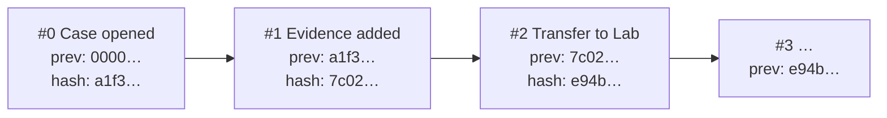
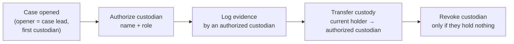

# Custody Ledger

**A tamper-evident chain-of-custody log for digital evidence, written in Rust.**

When digital evidence (phone images, CCTV footage, documents) changes hands, a firm needs to be able to
prove two things in court: that the file is exactly what was originally collected, and who held it, when,
and why. Custody Ledger records every step in a ledger where each record is cryptographically linked to the
one before it. If anyone edits, deletes or reorders a past record, or changes an evidence file,
verification fails and points to exactly where.

The project has two front ends that share the same core:

| | |
|---|---|
| **`custody` command-line tool** | For staff working with real evidence folders on their computer |
| **Web app** (Vercel) | The same Rust code compiled to WebAssembly. Files are hashed in the browser and never uploaded |

**Demo video:** a 2-minute walkthrough plays on the start page of the web app
([web/demo/custody-ledger-demo.mp4](web/demo/custody-ledger-demo.mp4)).

## Using the web app

- **Start page**: watch the walkthrough, open the **sample case**, start a new case, or open a saved case file.
  The *Test it yourself* section has downloadable original and altered sample files.
- **Inside a case**, the status panel at the top always shows whether the custody log is intact. Five tabs:
  - **Overview**: the three main actions (Log evidence, Transfer custody, Verify a file), a getting-started
    checklist, summary numbers, and recent activity.
  - **Evidence**: one card per file with category and current custodian, plus search and a category filter.
  - **Custodians**: the authorized custodian list (add or revoke).
  - **Custody log**: the full timeline, filterable, with optional technical details (fingerprints).
  - **Integrity**: verify a file, the integrity receipt, and a tampering demonstration.

---

## How it works

Every record stores a **SHA-256 hash** (a 64-character fingerprint) of its own contents *and* the hash of
the record before it:



`verify` walks the chain and checks four things for every record:

1. **Position**: record numbers are 0, 1, 2… with no gaps (catches deletions and reordering)
2. **Link**: `prev_hash` equals the previous record's hash
3. **Contents**: re-hashing the record gives the stored hash (catches edits)
4. **History makes sense**: evidence exists before it's transferred, only the current holder can transfer it,
   only authorized custodians act or receive evidence, nobody is removed from the list while holding evidence,
   and time never runs backwards

The CLI also re-hashes every evidence file on disk and compares it with the hash recorded when it was logged.

### Authorized custodians

Evidence may only be held by people or organizations on the case's **authorized custodian list**:



The list isn't a separate table that could be quietly edited. Authorizations and revocations are records in the
same hash chain, so they're as tamper-evident as everything else. `verify` replays the list as it stood at each
point in time, so a forged transfer to someone who wasn't authorized *then* is caught even if every hash is valid.
Names are matched ignoring case and extra spaces, and stored with the spelling used on the list.

### Verifying a file

A file's fingerprint is SHA-256 over every byte of it. The same bytes always give the same fingerprint, and
changing even one byte gives a completely different one. Verifying a copy means fingerprinting it now and
comparing it with the fingerprint recorded when it was logged. The file name doesn't matter, only the content.
Note that opening and re-saving a file, or sending it through apps that compress attachments, changes its bytes
even when it looks the same.

**What if someone rewrites the *whole* ledger and recomputes every hash?** The chain would then be
internally consistent. That's why there's a *head hash*: the hash of the newest record. Send it to the client
or put it in a filing. Later, `custody verify --anchor <hash>` proves the history you sent still exists
unchanged inside the ledger. A rewritten history can't contain it.

---

## Project structure

```
crates/
  custody-core/   The logic. Records, hashing, the chain, verification. No file or network I/O.
    src/hash.rs     SHA-256 helpers (streams large files in 64 KB chunks)
    src/record.rs   What a record looks like + how its hash is computed
    src/ledger.rs   Cases, custodian list, evidence, transfers, and the business rules
    src/verify.rs   Walks the chain and reports every problem in plain English
    tests/chain.rs  34 tests, including 11 different tampering attacks
  custody-cli/    The `custody` command (argument parsing, files, coloured output)
    tests/cli.rs    9 end-to-end tests that run the real program
  custody-web/    Thin WebAssembly wrapper exposing the core to JavaScript
web/              Static site: index.html, style.css, app.js, pkg/ (compiled wasm), samples/
  sample-evidence/  Fictional originals, tampered/untampered copies, a sample case + zip (served on the site)
scripts/          build-web.ps1 / .sh   compile the Rust core to WebAssembly
                  serve.py              local server (no caching, supports video seeking)
                  demo.ps1              guided command-line demo
                  make-sample-evidence.mjs  generates the sample originals and altered copies
                  record-demo.mjs       records the demo video (headless Edge + MediaRecorder)
                  fix-mp4-duration.mjs  writes the real length into the recorded MP4's header
vercel.json       Serves web/ as a static site with security headers
```

**Design decisions**

- **One core, two front ends.** All rules live in `custody-core`, so the CLI and the web app can't disagree.
- **The core does no I/O.** The caller supplies timestamps and file hashes. This makes the core easy to test
  and lets it compile to WebAssembly, where there's no file system or clock.
- **Deterministic hashing.** A record's hash is SHA-256 of its fields serialized to JSON in a fixed order.
- **Refuse to build on a broken chain.** Adding to a ledger that already fails verification is rejected, so new
  records can never "bless" tampered history.
- **Safe saves.** The CLI writes to a temp file and renames it, so a crash can't leave a half-written ledger.
- **Privacy.** In the web app, evidence never leaves the user's computer. Only hashes are stored.

---

## Using the command-line tool

Requires [Rust](https://rustup.rs). From the project folder:

```bash
cargo build --release
# the program is now at target/release/custody(.exe)
```

```bash
custody init --case CV-2026-0142 --title "People v. Dela Cruz" --by "Atty. M. Cruz"
custody authorize "Forensics Lab" --role "Forensic laboratory" --by "Atty. M. Cruz" --note "Accreditation 77"
custody add web/samples/call_log.csv --by "Atty. M. Cruz" --category "Device extraction" --desc "Call log from phone"
custody transfer 1 --by "Atty. M. Cruz" --to "Forensics Lab" --reason "Metadata analysis"
custody custodians               # authorized custodian list
custody revoke "Forensics Lab" --by "Atty. M. Cruz" --reason "Engagement ended"   # only if they hold nothing
custody list                     # evidence, category + current custodian
custody history 1                # one item's custody trail (omit the id for everything)
custody verify                   # check chain + re-hash every file
custody head                     # print head hash to store elsewhere
custody verify --anchor <hash>   # also prove history wasn't rewritten
custody check 1 some_copy.csv    # is this file identical to evidence #1?
```

Use `--log path/to/case.json` to work with a ledger other than `./custody.json`.
Exit codes: `0` OK, `1` verification failed, `2` error. This makes it scriptable.

### 2-minute demo

```bash
custody verify            # VERIFIED
# now open custody.json, change any description, save
custody verify            # TAMPERING DETECTED: Record #1 was modified after it was written
# or edit one byte of the evidence file instead
custody verify            # #1 call_log.csv: MODIFIED since it was logged
```

For a guided version, run `scripts/demo.ps1` (or the VS Code task **Demo: command-line tool**).

The web app does the same for non-technical users. Open **"Demonstration: how tampering is detected"** and
alter a description, substitute a file and conceal it, or delete a log entry. The status panel turns red and
names the exact entry.

### The web app, for everyday users

The web app hides the technical parts (hashes, JSON) unless you tick **Show technical details**:

| What the user sees | What it does technically |
|---|---|
| Log evidence (category dropdown, "Other (specify)") | Hash the file, append an `evidence_added` record |
| Authorized custodians → Add / Revoke | Append `custodian_authorized` / `custodian_revoked` records |
| Transfer custody (receiver chosen from the authorized list) | Append a `custody_transferred` record from the current holder |
| Verify a file / Verify copy | Hash the file; look it up among all logged fingerprints, or compare with one item |
| Acting as | Which authorized custodian is making entries |
| Custody log verified / tampering warning | Result of `verify()`, with each issue rewritten in everyday words |
| Integrity receipt | The head hash. "Verify a receipt code" = `verify --anchor` |
| Save case file / Open case file | Export / import the ledger JSON |

---

## Running tests

```bash
cargo test
```

45 tests cover normal use, business rules (only authorized custodians can hold evidence, only the holder can
transfer, no revoking someone who holds evidence, no duplicate files, required category), and tampering: edited
record, edited record with recomputed hash, deleted record, reordered records, forged transfer, forged transfer
to an unauthorized person, forged entry by an unauthorized person, forged revocation, back-dated record, full
rewrite caught by the anchor hash, modified and missing files.

---

## Web app & deploying to Vercel

The web app is a static site in `web/`. The compiled WebAssembly is committed in `web/pkg/`, so Vercel just
serves the folder. No build step and no Rust on Vercel's side.

**Sample evidence for testers**: the start page has a **Test it yourself with sample evidence** section.
It opens a ready-made sample case and offers downloads of altered and untouched copies to verify, with a
Reveal button for the answers. The files live in `web/sample-evidence/`, and `node scripts/make-sample-evidence.mjs`  
regenerates them (see that folder's README).

**Re-recording the demo video** (after UI changes): start `python scripts/serve.py 4180`, then run
`node scripts/record-demo.mjs`. It drives the real app in headless Microsoft Edge with an on-screen cursor and
captions, captures every repaint, and encodes the frames with the browser's own `MediaRecorder`, so no ffmpeg is
needed. The browser leaves the total length out of the MP4 header (it writes the file in fragments as it goes),
so `fix-mp4-duration.mjs` adds it afterwards.

**Run locally**: `python scripts/serve.py` and open <http://localhost:4173> (or the VS Code task
**Web app: open in browser**). This server turns off browser caching, so you never run a stale mix of old and
new files after a rebuild. Opening `index.html` directly from disk won't work, because browsers block
WebAssembly loaded from `file://`.

**Rebuild the WebAssembly after changing Rust code:**

```bash
rustup target add wasm32-unknown-unknown                     # once
cargo install wasm-bindgen-cli --version 0.2.130 --locked    # once
powershell -ExecutionPolicy Bypass -File scripts/build-web.ps1   # or: sh scripts/build-web.sh
```

**Deploy**: push to GitHub, import the repo in Vercel (no settings needed; `vercel.json` handles it),
or with the CLI: `npm i -g vercel` then `vercel --prod` from the project folder.

---

## Limitations (and what I'd add next)

- **Hashes prove *whether* something changed, not *who* changed it.** Next step: each person signs their
  records with their own key (Ed25519 digital signatures).
- Identities aren't verified. The custodian list controls *who may hold* evidence, but anyone using the app can
  pick a name under "Acting as". Signatures (above) or user logins would bind each entry to a real person.
- Case files from before the custodian list (format version 1) can't be opened by this version.
- The web app stores the ledger in the browser. Export it to keep it. A shared multi-user version would need
  a server and logins.
- Timestamps come from the computer's clock. A trusted timestamping service (RFC 3161) would make them
  independently verifiable.
- This is an integrity tool, not legal advice. Admissibility rules for electronic evidence still apply
  (in the Philippines, the Rules on Electronic Evidence).

## Tech

Rust 2021 · `sha2` · `serde` / `serde_json` · `clap` · `chrono` · `colored` · `wasm-bindgen` · vanilla
HTML/CSS/JS · Vercel (static hosting)

## License

MIT
