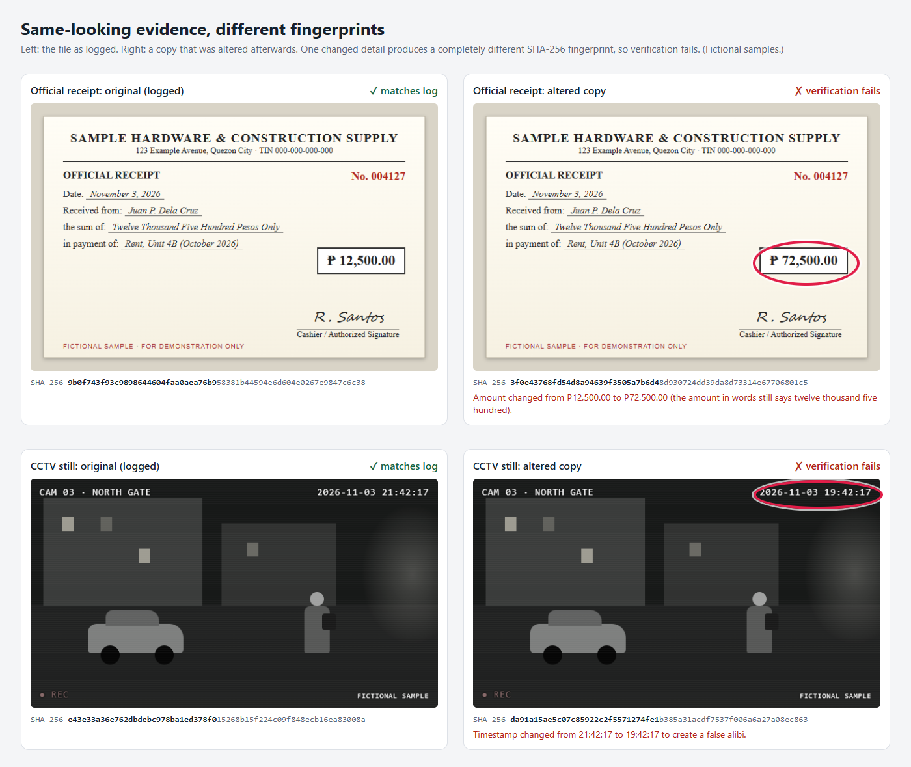

# Sample evidence: tampered vs. untampered

Fictional files for demonstrating Custody Ledger. Names, amounts and places are made up.

These files are part of the website. Testers can open the sample case and download every file from the
**Test it yourself with sample evidence** section on the start page, or download them all as
`sample-evidence.zip`.

```
web/sample-evidence/
  1-originals/            the evidence as it was collected (already logged in sample-case.json)
    sample-case.json      a ready-made case: 5 items, 3 custodians, 2 transfers
  2-copies-to-verify/     copies that turned up later: some untouched, some altered
  comparison.png          side-by-side picture of the two altered images, for slides
```



## What each copy shows

| Copy in `2-copies-to-verify/` | What was done to it | Can you see it? | Result |
|---|---|---|---|
| `bank_statement.csv` | Nothing, exact copy | – | ✓ Verified, item 3 |
| `receipt_copy_for_client.png` | Nothing, only **renamed** | – | ✓ Verified, item 2 (the name doesn't matter, only the content) |
| `payment_receipt.png` | Amount changed from ₱12,500.00 to ₱72,500.00 | Only if you compare closely (the amount in words wasn't changed) | ✗ Altered |
| `cctv_still.png` | Timestamp changed from 21:42:17 to 19:42:17 (a false alibi) | Only if you compare closely | ✗ Altered |
| `lease_agreement.txt` | Payment period changed from "thirty (30) days" to "ninety (90) days" | One phrase in a full page of text | ✗ Altered |
| `chat_export.txt` | **One invisible space** added after "I will pay on Friday." | **No.** The two files look identical | ✗ Altered |

The last row is the strongest point in a demo: the two files are visually identical, yet the fingerprint still
catches the change. A human reviewer would never spot it.

## Demo in the web app (about 2 minutes)

1. On the start page, click **Open sample case** (or **Open case file** and choose `1-originals/sample-case.json`).
   It opens showing **Custody log verified**, with 5 evidence items and 3 authorized custodians.
2. Click **Verify a file** and choose `2-copies-to-verify/bank_statement.csv`.
   Result: ✓ *Verified: this is item 3, unaltered.*
3. Verify `2-copies-to-verify/receipt_copy_for_client.png`.
   Result: ✓ *item 2*. Renaming a file doesn't affect it.
4. Verify `2-copies-to-verify/payment_receipt.png`.
   Result: ✗ *Item 2 has the same name, but this copy's content is different.* The two fingerprints are shown
   side by side.
5. Verify `2-copies-to-verify/chat_export.txt`. Open it next to `1-originals/chat_export.txt` first and point
   out that you can't see a difference. Result: ✗ altered.
6. Optional: on an evidence card, use **Verify copy** to compare a file against that one specific item.

You can also start from scratch: open a new case, log the files in `1-originals/` yourself, then verify the
files in `2-copies-to-verify/`.

## Demo with the command-line tool

```bash
custody --log web/sample-evidence/1-originals/sample-case.json verify
custody --log web/sample-evidence/1-originals/sample-case.json check 3 web/sample-evidence/2-copies-to-verify/bank_statement.csv
custody --log web/sample-evidence/1-originals/sample-case.json check 2 web/sample-evidence/2-copies-to-verify/payment_receipt.png
```

The first two report MATCH and VERIFIED. The third reports **DIFFERENT**.

## Fingerprints (SHA-256)

| File | Original | Copy |
|---|---|---|
| lease_agreement.txt | `bf3d8c1d19dd…` | `a0f06375ea46…` ✗ |
| chat_export.txt | `f69552d45737…` | `a6d69729b45f…` ✗ |
| bank_statement.csv | `9ee389236cae…` | `9ee389236cae…` ✓ |
| payment_receipt.png | `9b0f743f93c9…` | `3f0e43768fd5…` ✗ |
| receipt_copy_for_client.png | – | `9b0f743f93c9…` ✓ (same as the original receipt) |
| cctv_still.png | `e43e33a36e76…` | `da91a15ae5c0…` ✗ |

Check them yourself on Windows with `certutil -hashfile <file> SHA256`, or `sha256sum <file>` on macOS/Linux.

## How these were made

`node scripts/make-sample-evidence.mjs` writes the text files directly and draws the images as small web pages,
photographed with headless Microsoft Edge. Each altered image is drawn from the same page as its original with a
single value changed, so the two differ only in that spot. The case file was then built with the real `custody`
command-line tool. Note: re-running the script redraws the images, so their fingerprints change and
`sample-case.json` has to be rebuilt.
